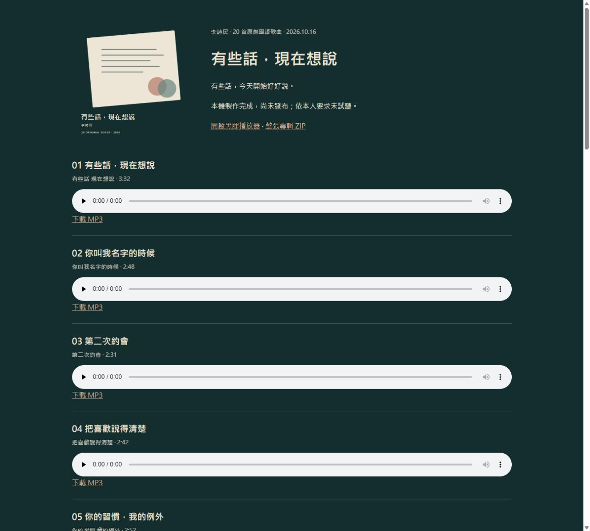

# 雙專輯交付與驗收

日期：2026-10-16（台灣時間）。狀態：本機製作完成、技術驗證通過；依本人要求未試聽，未發布。

| 專輯 | 曲目 | 實際音檔總長 | ZIP |
| --- | ---: | --- | --- |
| 我還想去的地方 | 20 | 57:39.192 | [整張專輯](../../../assets/audio/places-to-go/places-to-go-album.zip) |
| 有些話，現在想說 | 20 | 60:17.232 | [整張專輯](../../../assets/audio/words-to-say/words-to-say-album.zip) |

## 生成與額度

- 使用 Suno V6、帳號 subliminalsongbirds009、既有本人 Voice「2026/03/27」（b0593d92-dd06-4602-80fa-e701e89ee2d7）。生成前核對選取項目，生成後逐候選核對 Voice URL。這證明指定聲音設定的使用，不代表已聽審實際聲音身分。
- 40 次生成請求、80 個候選，逐首任選第一個觀察到的候選，共下載 40 個不同作品；另 40 個候選保存來源與提示詞紀錄，未下載音檔。
- 帳號頁重新讀回：9,934 → 9,534 點，使用 400 點；下載 46 → 6 首，使用 40 首。未購買、加值、改方案或另建 Voice。
- 下載彈窗顯示 Refreshes 10/17/26；確切重置時間／時區未列出，保持未知。創作頁後段徽章延遲讀值保留，不用它推算最終成本。

## 保存與驗收

- 40 首原始 MP3 保留於原下載位置，逐首另存 albums/<album-id>/downloads/，播放器副本放在 assets/audio/<album-id>/；三者 bytes／完整 SHA-256 相符。沒有轉檔或覆寫原音訊。
- 40/40 首重新 FFprobe／FFmpeg 完整解碼至宣告結尾，均有聲；vocals 維持 unknown，未試聽、未以 ASR 或有聲量測冒充人聲與藝術接受。
- 兩個專輯驗證入口沿用共用實作，均通過，讀回六張專輯、各 20 首；預設唯讀，保存報告使用新路徑獨佔建立。
- 兩個 ZIP 各 23 項：20 首原始位元組 MP3、封面 SVG、歌詞與提示詞、歌曲來源。46/46 項內容 SHA-256 核對通過。
- 原有 488 個基線檔案中 484 個保持完全相同；僅修改白名單 README.md、albumData.js、index.html、sw.js，四份修改前完整備份均核對基線通過。原有 120 個 MP3、2 個 ZIP、歷史帳本、失敗紀錄及舊報告保留。
- 原先四張專輯的完整資料與 HEAD 版本一致；六張共 120 首。本機 40 個音檔 HEAD、兩張下載頁各 20 首連結、ZIP HEAD 大小、HTTP Range 206、19 個快取路徑通過。此為隔離本機預覽，不能當作 Vercel 公開驗收。
- 既有回歸測試 15/15 通過，修改的四個 JavaScript 資料／快取入口語法檢查通過；沒有 package.json，未執行或宣稱 npm build/lint。
- 本機瀏覽器確認六張作品庫、專輯切換、新專輯 20 首曲目、封面及第六張第 20 首直達頁；音訊保持暫停。桌面視窗未見水平溢出，不代表手機實機驗收。
- 40 首已建立本機音樂庫增量待整理清單；未查雲端完整索引、未上傳、未標記正式 READY。

## 失敗與恢復

- 初次未篩選的 Voice 選取讀回不符，在生成前攔住；搜尋精確名稱並核對 Voice ID 後才送出，該修正無扣點。
- MP3 預設已勾選，初次再點一次取消格式，造成解鎖按鈕停用；先核對餘額 46 與無新檔，恢復勾選後才做第一次實際解鎖。
- 原生 download 事件未回報時，讀回本機檔案與雜湊，不盲目重按。第二張第 6 首有明確 Download failed，確認無原檔／暫存檔並讀回「已解鎖」，僅對同一作品恢復一次下載，成功且沒有再扣解鎖額度。
- 第一次 ZIP 使用 PowerShell 5.1 遇到 UTF-8 中文路徑錯誤，失敗 ZIP 與腳本保留；用 PowerShell 7 重建新 ZIP 後逐項驗證通過。詳見 recovery-and-limitations.json。

## 邊界與檔案入口

- HEAD 仍為 559d1db3944a35b8e21dbfd6c1f5be3fe806ccfd；索引條目與修改前完全相同，未暫存、未新增提交、未推送、未部署。既有三筆本機提交保持原樣。
- 本機預覽：http://127.0.0.1:8771/ 。本輪預覽伺服器只綁定 loopback；內部帳本隔離僅驗證此預覽，實際部署仍須另驗。
- 新專輯帳本：albums/places-to-go/album.json、albums/words-to-say/album.json；每張有逐候選生成備註 JSONL、20 首歌詞與提示詞、來源連結、逐曲交易與原檔保存副本。
- 證據：quota-receipt.json、final-audio-and-preservation.json、兩份 release-check.json、兩份 zip-verification.json、local-http-verification.json、browser-verification.json、delivery-manifest.json。

## 本輪流程試行

本輪以本機唯讀頁把已保存歌詞／提示詞送入瀏覽器，再用僅限 loopback、檢查 Origin 的本機表單將實際觀察的候選與下載證據存成獨佔新檔。40 首逐首表單內容核對及保存讀回通過，避免大量轉抄；來源頁與證據表單伺服器已停止，本機預覽保留供檢視。原有 Suno 原生 UI、交易與完整音檔驗證仍是穩定路徑。

建議將此方式作為可選的本機專輯製作輔助流程，優點是減少轉抄與保留每次讀回；取捨是多兩個短期本機端點，須限制 loopback 並在收尾關閉。依使用者提供的 AGENTS.md「自我優化規則」：通過後須詢問是否正式納入；本輪尚未升級為固定規則。

最後保存盤點：見 final-preservation.json。核心交付清單另補入兩份專輯交付指引，以 delivery-manifest-final.json 為最終清單，共 267 個檔案；初版清單保留。
